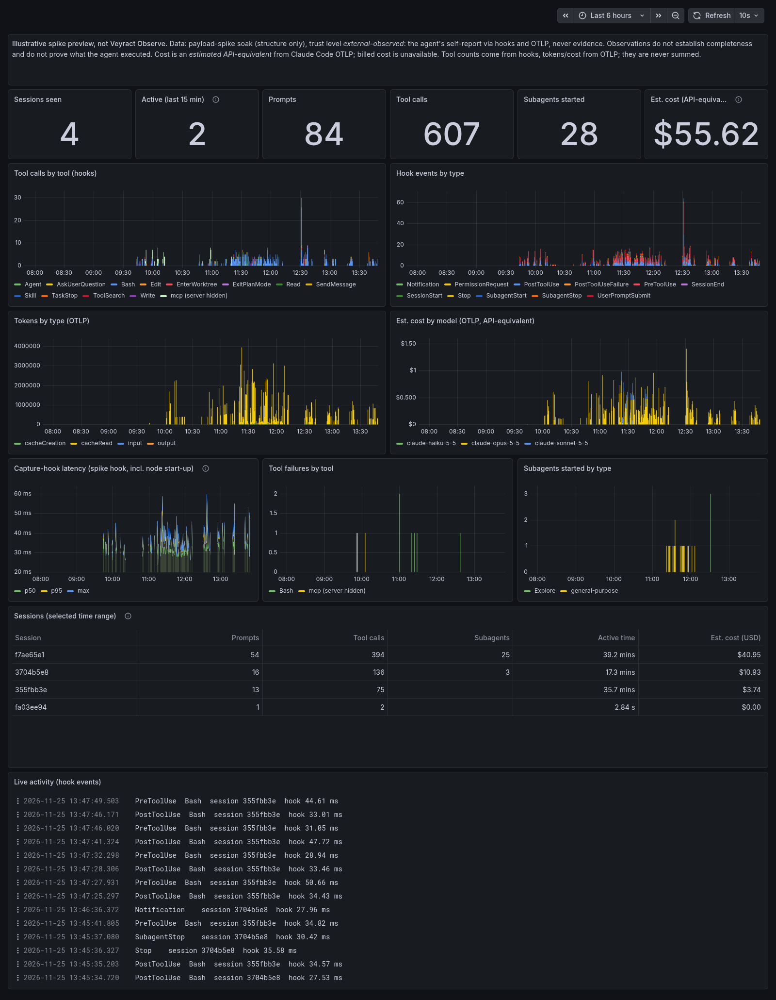
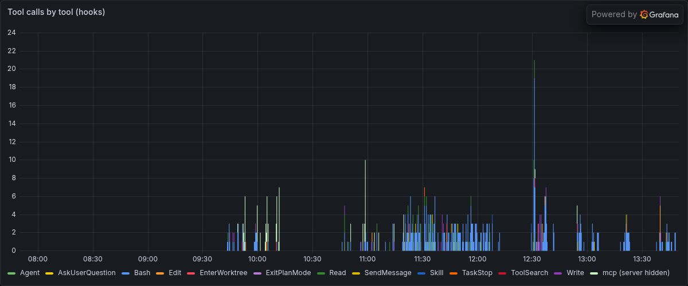
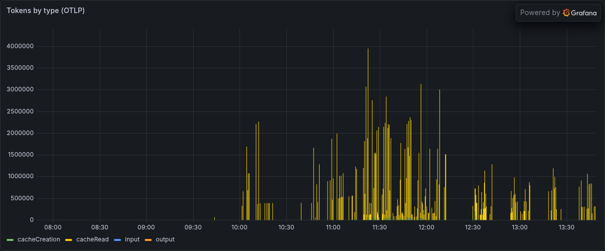
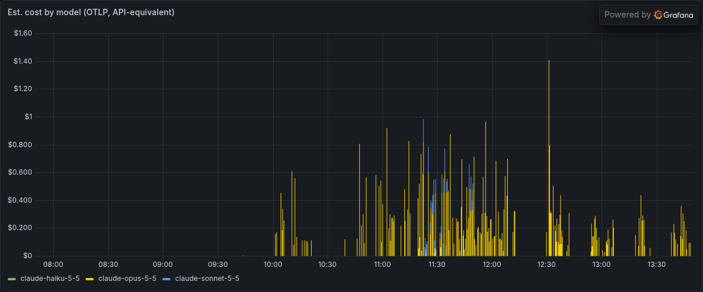
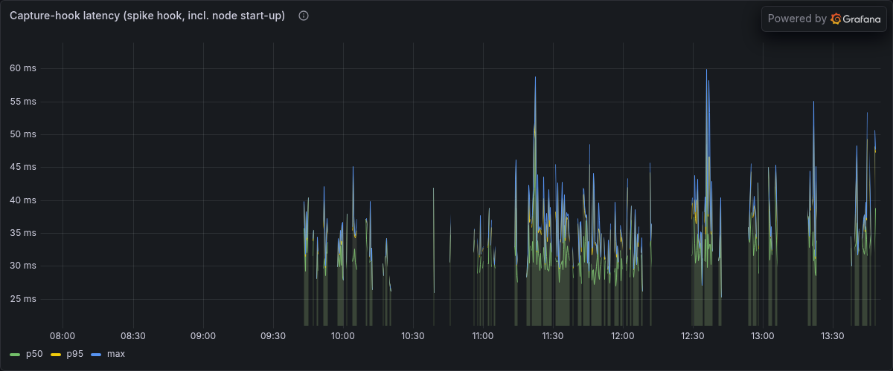
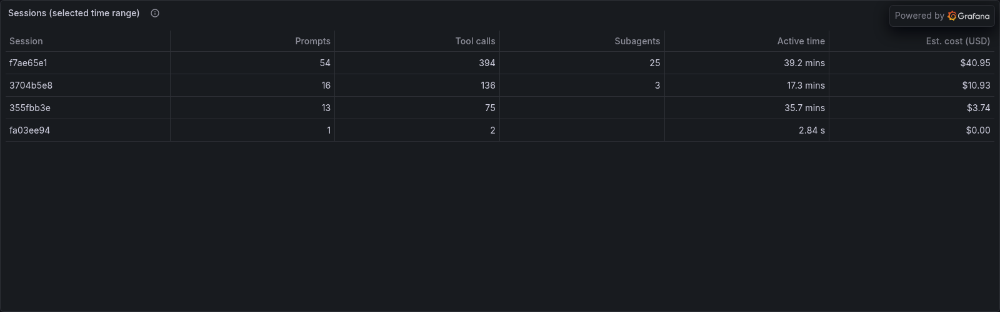
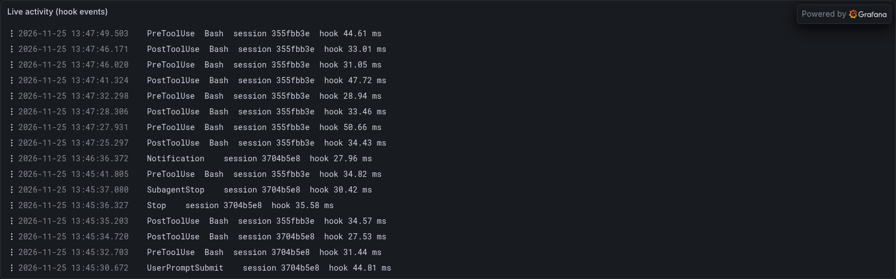

# Preview: Grafana dashboards for your coding-agent sessions

> **Planned, not released.** Nothing on this page is available in veyract observe yet. The screenshots
> are **illustrative**: they were made with a throwaway prototype, not with this codebase, from the
> maintainer's own Claude Code sessions (Claude Code 2.1.332, 25 Nov 2026, last 6 hours). Layout, panels and
> numbers will change.

veyract observe works with Claude Code. It keeps its own local store; for people who already use Grafana,
the plan is an **export** that writes immutable records (events, usage samples) as rotating NDJSON files on
your machine. A log shipper such as Grafana Alloy picks them up, Loki stores them, and Grafana shows them.
Export is **off by default** and only carries projected metadata; it never carries identity attributes,
prompt text, file contents or tool output.

```
Claude Code ──hooks / OTLP──▶ veyract observe (local store) ──NDJSON export──▶ Alloy ──▶ Loki ──▶ Grafana
```

## What you would see



- **Summary**: sessions seen and recently active, prompts, tool calls, subagents, estimated cost.
- **Tool calls by tool** and **hook events by type** over time.
- **Tokens by type** and **estimated cost by model**.
- **Capture-hook latency**: the capture hook must never slow a session down; its internal budget is 200 ms.
- **Tool failures** and **subagents by type**.
- **Sessions table** and a **live activity feed**.

### Tool calls by tool



### Tokens and estimated cost





### Capture-hook latency



### Sessions and live activity





## How to read these numbers

- **Self-reported, not evidence.** Every observation is the agent's own report via Claude Code hooks and
  telemetry (trust level *external-observed*). It does not establish completeness and does not prove what the
  agent executed.
- **Cost is an estimate.** It is an *estimated API-equivalent* from Claude Code's own usage telemetry; billed
  cost is unavailable.
- **Two sources, never added together.** Tool counts and timings come from hooks; tokens and cost come from
  telemetry.
- **Empty means unavailable**, not zero.
- **Privacy in these images**: MCP tool names are collapsed to `mcp (server hidden)`, session ids are cut to
  eight characters, and no account or identity attributes are shown. Tool and model names are readable here,
  which corresponds to the `detailed` level; the default `metadata` level pseudonymises open-ended names.
